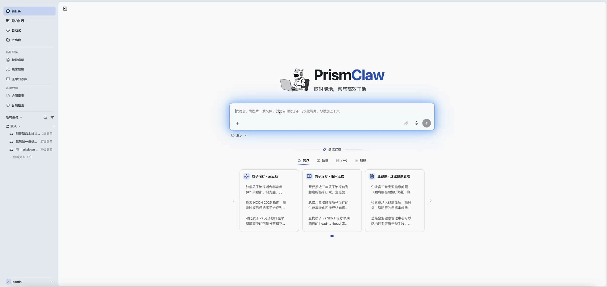
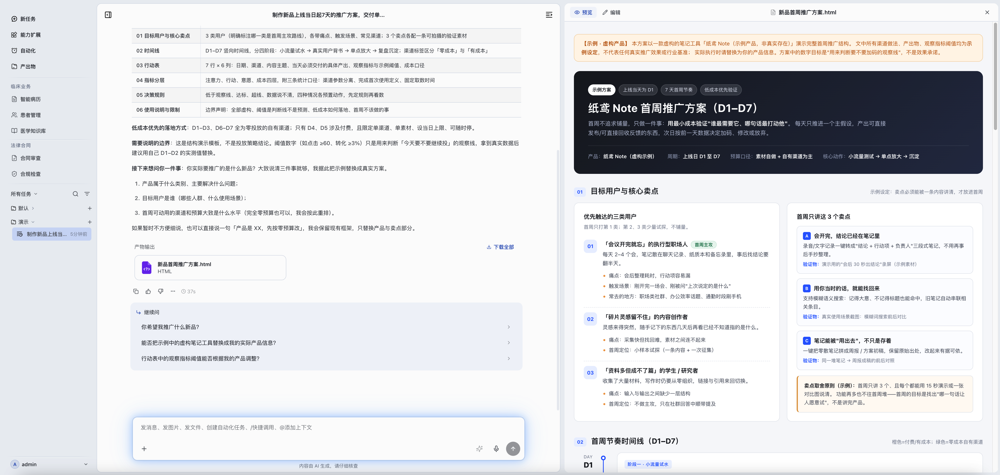
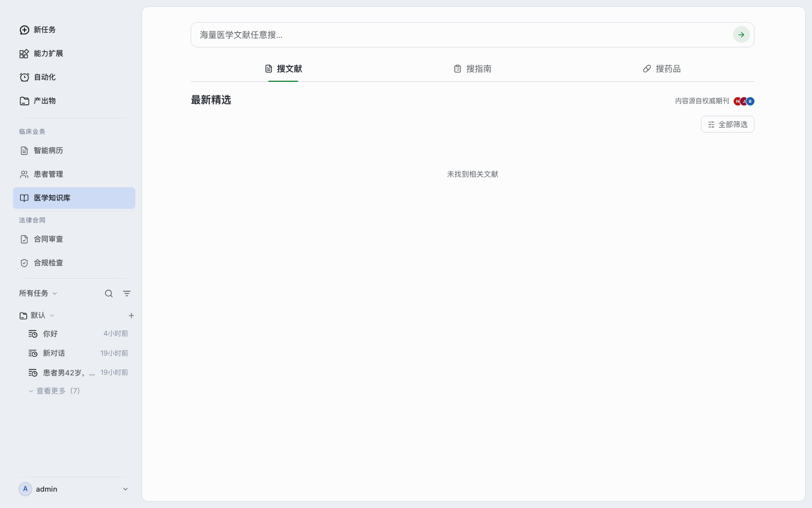
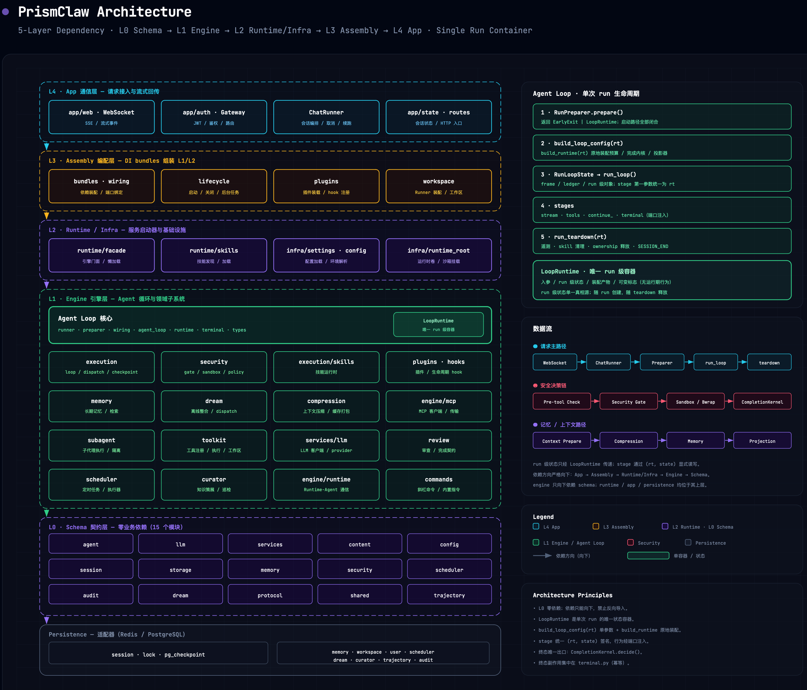

<div align="center">


# PrismClaw

**Enterprise-grade · Private deployment · Multi-user · Multi-agent**

Put the AI agent back on your own infrastructure

[](./LICENSE)
[](https://www.python.org/)
[](https://react.dev/)
[](./deploy/DEPLOY.md)

[**English**](./README.md) · [简体中文](./README.zh-CN.md)



<p align="center"><sub>Real run · switch scenarios → run a task → execution trace on the left, download-ready artifact on the right</sub></p>

</div>

> **Status:** beta. The medical domain is the reference implementation; legal has navigation and a page skeleton only; office and research run as general agent tasks.

---

## Why we built this

Most AI tools assume three things: the network is open, users will configure things, and a chat reply is the finish line. Inside an enterprise, none of the three holds.

- **Data cannot leave.** Medical records, contracts and internal documents cannot be uploaded to a public cloud. That is a hard constraint, not a compliance preference.
- **Users do not configure.** Doctors, lawyers and admin staff will not read plugin docs, fill in model endpoints or manage API keys just to do their job.
- **Delivery is not a chat.** They need a file that can be signed, sent and archived, not an answer that still has to be reorganized by hand.

So PrismClaw inverts all three: the whole stack runs on your own machines, staff open a browser and start working, and the task ends with a file. It is not a chat box — it is a delivery system that puts an agent inside a real business process.

---

## Scenarios and delivery

The PC workbench exposes four task entries — **medical, legal, office, research**. They share one agent runtime, but they are not at the same maturity level; a visible entry does not mean a finished dedicated workbench.

| Scenario | Current state | Tasks and outputs |
| --- | --- | --- |
| **Medical** | Reference implementation, dedicated workbench shipped | Record and course-of-illness drafting, guideline / literature / drug lookup, dosimetry comparison, follow-up plans; evidence is cited, clinical decisions stay with the physician |
| **Legal** | Navigation and page skeleton in place, dedicated workbench in progress | Contract review and compliance check entries are visible; review deliverables await the dedicated workbench |
| **Office** | General agent tasks | Document processing and format conversion, meeting notes and action items, workflow automation; outputs as HTML / Markdown reports, spreadsheets or files |
| **Research** | General agent tasks | Literature review, material organization, draft writing and data analysis; results depend on the models, tools and data sources you connect |

---

## How a task runs

1. **Describe the goal.** Write it in natural language, pick a workspace, optionally @ a file or knowledge base.
2. **The agent plans.** It plans, retrieves, calls skills and tools, reads files, writes code and generates documents — each step visible on the left.
3. **Preview on the right.** Not satisfied? Ask a follow-up; it edits the same artifact instead of starting over.
4. **Take it away.** Download the file. For sensitive actions (sending externally, writing to a system, bulk changes) it stops and waits for approval.

<table>
  <tr>
    <td width="50%" valign="top">
      
      <p align="center"><sub>Conversation · task trace on the left, artifact preview on the right</sub></p>
    </td>
    <td width="50%" valign="top">
      
      <p align="center"><sub>Medical knowledge base · search entry; no literature data in the captured environment</sub></p>
    </td>
  </tr>
</table>

---

## What we deliberately don't do

### No user-installed extensions

Opening skills, plugins and MCP to every user sounds free, but in a real company it means version mismatches, dependency conflicts and leaked keys. Extensibility belongs to IT during acceptance, not to frontline users. Built-in capabilities are individually adapted and regression-tested; new domains ship as vetted domain packs.

### No desktop client

A native client is faster and closer to the OS, at the cost of installing, upgrading and troubleshooting every machine. One department with twenty PCs means twenty maintenance points. PrismClaw is browser/server: deploy once, upgrade on the server, zero install for users.

### No unnecessary knobs

Every toggle asks the user to make one more judgment. Model selection, context assembly and skill routing stay in the backend. Users do two things: say what they want, and take what they asked for.

---

## Capabilities

| Capability | What it means |
| --- | --- |
| **Private deployment** | The whole stack runs on your machines; data never reaches a third party. Models can point at an intranet OpenAI-compatible endpoint. |
| **Multi-user isolation** | Accounts, sessions, memory and artifacts are isolated per user; one platform serves the whole organization. |
| **Works out of the box** | One command starts the stack; browser login, PC and mobile H5, zero install. |
| **Five-layer architecture** | `schema → engine → runtime → assembly → app` with strict one-way dependencies. |
| **Horizontal scale** | Stateless workers, scale out on demand; a failed node is taken over automatically without dropping sessions. |
| **Four-layer memory + Dreaming** | L1 working / L2 session / L3 semantic / L4 archive; idle-time consolidation makes the system learn your business. |
| **Security governance** | Multiple gates, kernel-level sandbox, DLP; sensitive actions require task-level confirmation and are auditable. |
| **Domain onboarding** | Domains are onboarded as vetted packages by IT; users configure nothing. Medical is the reference implementation. |

---

## Deploy

> Nothing to install on the client. Prepare the server and staff log in from a browser.

> **Requirements:** Docker 24+ (recommended), or from source: Python 3.12+, [uv](https://docs.astral.sh/uv/), Node.js 18+, Redis 7, PostgreSQL 17 (VectorChord Suite: `vchord` / `pg_tokenizer` / `vchord_bm25` / `vector`).

### Option 1: Docker (recommended, single host)

```bash
# 1. Generate local configs
cd backend/configs && for f in *.example.yaml; do cp "$f" "${f%.example.yaml}.yaml"; done && cd ../..
# Edit deploy/configs/mcp.prod.json if you need extra MCP connectors
# Only models.yaml needs your endpoint and API key (an intranet OpenAI-compatible service works)

# 2. Set deployment secrets and the admin password
cd deploy && cp .env.example .env && ${EDITOR:-vim} .env

# 3. Start (the first run builds the image)
docker compose up -d
```

- Open `http://<server-ip>:8000` and log in with the admin account from `.env` (created on first boot).
- Stop with `docker compose down`; logs with `docker compose logs -f prismclaw`.

### Option 2: Local development from source

```bash
cd backend && uv sync && cd ..
cd backend/configs && for f in *.example.yaml; do cp "$f" "${f%.example.yaml}.yaml"; done && cd ../..
# Edit models.yaml, server.yaml (jwt_secret), infra.yaml (Redis / PostgreSQL)

./scripts/build-frontend.sh       # PC → frontend/dist
./scripts/build-frontend-app.sh   # mobile H5 → frontend-app/dist/h5

export PRISMCLAW_WEB_USER_BOOTSTRAP_ADMIN_ID=admin
export PRISMCLAW_WEB_USER_BOOTSTRAP_ADMIN_PASSWORD='<set-a-strong-password>'
./scripts/dev/start-local.sh      # backend + local static hosting (stands in for nginx)
open http://localhost:5173
```

| Entry | URL |
| --- | --- |
| PC | `http://localhost:5173` |
| Mobile H5 | `http://localhost:10086` |
| API | `http://localhost:8000` |

- Stop with `./scripts/dev/stop-local.sh`.
- Registration and password reset depend on SMTP; without it those endpoints return 503, login is unaffected.
- Frontend hot reload: `cd frontend && npm run dev` (point `/api` at the backend).

---

## Boundaries and FAQ

**What it does not do:**

- It does not replace HIS / EMR — it reads, organizes and drafts, but does not take over core hospital systems.
- It does not give diagnoses — it returns cited evidence and options; the decision stays with the physician.
- It does not send data out — models can run entirely on intranet inference.
- It does not silently perform sensitive actions — sending, writing and bulk changes always wait for confirmation.

| Question | Answer |
| --- | --- |
| Does it need internet access? | No. Models can use an intranet OpenAI-compatible service; retrieval and inference stay inside. |
| What do users install? | Nothing. Open a browser and log in. |
| Where is data stored? | Your own Redis / PostgreSQL; backup and audit remain under your control. |
| How long is onboarding? | The first sentence after login is enough; there are no configuration options to learn. |

---

## Who is behind it

PrismClaw is maintained by [JsonShare](https://github.com/JsonShare). The goal is an agent platform that a company can actually deploy and keep running, not another demo. The medical domain is fully open-sourced as the reference implementation; new domains reuse the same layering and onboarding path.

- Found a problem or have an idea: open an [Issue](https://github.com/JsonShare/PrismClaw/issues)
- Want to contribute: read [CONTRIBUTING.md](./CONTRIBUTING.md) first
- Security issues: please do not disclose publicly, see [SECURITY.md](./SECURITY.md)

---

# Appendix

## Architecture

<a href="./docs/architecture/diagrams/system-architecture.html">
  
</a>

Dependencies flow strictly one way; the engine layer is stateless and storage is independent, so workers scale out on demand. Click the image for the interactive diagram.

<details>
<summary>Layer dependencies (Mermaid)</summary>

```mermaid
graph TB
    subgraph L4["app — communication layer"]
        A1[WebSocket] ~~~ A2[Auth] ~~~ A3[Gateway] ~~~ A4[HTTP Routes]
    end
    subgraph L3["assembly — orchestration layer"]
        B1[Bundle assembly<br/>Infrastructure → Runtime → Lifecycle]
    end
    subgraph L2["runtime — runtime layer"]
        C1[engine facade] ~~~ C2[memory orchestration] ~~~ C3[capability refresh] ~~~ C4[ChatService]
    end
    subgraph L1["engine — engine layer (all business logic, stateless)"]
        D1[execution] ~ D2[sandbox] ~ D3[skills] ~ D4[plugins]
        D5[memory] ~ D6[Dreaming] ~ D7[compaction] ~ D8[MCP]
        D9[subagents] ~ D10[toolkit] ~ D11[LLM service] ~ D12[review]
    end
    subgraph L0["schema — contract layer (zero deps)"]
        E1[Protocol + types + config]
    end
    subgraph Store["Stateful storage (independent of workers)"]
        F1[("Redis<br/>sessions / locks / queues / L1")] ~ F2[("PostgreSQL<br/>L2-L4 / VectorChord / users / audit")]
    end

    L4 --> L3 --> L2 --> L1 --> L0
    L1 --> Store
```

</details>

## Configuration

Eight YAML files under `backend/configs/`, covering service, storage, models, agent and security policy:

| File | Contents |
| --- | --- |
| `server` | Listen address, runtime / workspace roots, web channel, JWT, SMTP |
| `infra` | Redis, PostgreSQL |
| `models` | Providers, default model, embedding / vision / speech |
| `agent` | Iteration limits, context budget and compaction, timeouts and retries |
| `mcp` | MCP server definitions |
| `capabilities` | Skill / subagent / plugin paths and quotas |
| `memory` | Four-layer memory and Dreaming curation |
| `security` | Sandbox, filesystem, network, environment variable allowlist |

## Deployment options

| Form | Entry | Fit |
| --- | --- | --- |
| Single-host Docker (recommended) | [`deploy/docker-compose.yml`](./deploy/docker-compose.yml) | One org, one server, includes PG + Redis + Runtime-Agent |
| Multi-worker cluster | [`deploy/docker-compose.multi.yml`](./deploy/docker-compose.multi.yml) | Nginx + 3 workers, active-active |
| Source production | `./scripts/start.sh` (stop with `./scripts/stop.sh`) | Backend only; frontend served by your existing nginx |
| Local development | `cd frontend && npm run dev` | Frontend hot reload |

The full deployment guide (ports, certificates, backups, environment variables) is in [deploy/DEPLOY.md](./deploy/DEPLOY.md).

## Tech stack

| Dimension | Technology |
| --- | --- |
| Architecture | Five-layer one-way dependencies + stateless workers + stateful storage, active-active scaling |
| Backend | Python 3.12+, FastAPI, Pydantic 2, SQLAlchemy 2 (async), litellm |
| Storage | Redis 7, PostgreSQL 17 (VectorChord Suite) |
| Frontend | React 19, TypeScript 5.8, Vite 6, Tailwind CSS 4, Zustand |
| Mobile | Taro 4.3, React 18, SCSS |
| Security | bwrap sandbox, JWT, DLP, BreakGlass, HSM |
| Observability | OpenTelemetry, Prometheus, structured JSON logs |
| Protocols | WebSocket, OpenAI-compatible SSE, MCP (stdio / streamable-http) |

## Project layout

```
backend/src/prismclaw/
├── schema/       L0 contracts: Protocol + types + config (zero deps)
├── engine/       L1 engine: execution · security · tools · memory · Dreaming · compaction · MCP · subagents · plugins
├── runtime/      L2 runtime: engine facade + memory orchestration / capability refresh / ChatService
├── assembly/     L3 assembly: bundle composition + plugin orchestration
├── app/          L4 communication: WebSocket · Chat · OpenAI SSE · gateway · auth
├── persistence/  Storage: PG memory / Redis sessions / users / audit
└── infra/        Infrastructure: settings · redis · db · startup checks

backend/src/subpackages/   Domain packages (medical is the reference implementation)
frontend/                  PC SPA (Vite + React)
frontend-app/              Mobile H5 (Taro)
deploy/                    Container orchestration · nginx · deployment docs
scripts/                   Build / local dev / production lifecycle
docs/architecture/         Architecture docs and interactive diagrams
```

## Docs

- [Architecture overview](./docs/architecture/architecture-prismclaw.md)
- [Interactive system diagram](./docs/architecture/diagrams/system-architecture.html)

Module deep dives:

| Area | Modules |
| --- | --- |
| Execution and orchestration | [Execution engine](./docs/architecture/modules/01-execution-engine.md) · [Runtime](./docs/architecture/modules/13-runtime-management.md) · [Scheduler](./docs/architecture/modules/16-scheduler.md) · [Subagents](./docs/architecture/modules/09-subagent.md) |
| Capabilities and integration | [Skills](./docs/architecture/modules/02-skill-system.md) · [Plugins](./docs/architecture/modules/03-plugin-system.md) · [MCP](./docs/architecture/modules/08-mcp-integration.md) · [Toolkit](./docs/architecture/modules/10-toolkit.md) |
| Memory and knowledge | [Memory](./docs/architecture/modules/05-memory-system.md) · [Dreaming](./docs/architecture/modules/06-dream-engine.md) · [Compaction](./docs/architecture/modules/07-context-compression.md) · [Curator](./docs/architecture/modules/15-curator.md) |
| Security and communication | [Sandbox security](./docs/architecture/modules/04-sandbox-security.md) · [Web layer](./docs/architecture/modules/12-web-layer.md) · [Review](./docs/architecture/modules/14-review-system.md) · [LLM service](./docs/architecture/modules/11-llm-service.md) |

## Contributing and security

Issues and PRs are welcome; see [CONTRIBUTING.md](./CONTRIBUTING.md) for the workflow. Please report security issues privately, see [SECURITY.md](./SECURITY.md).

## License

[MIT](./LICENSE)
