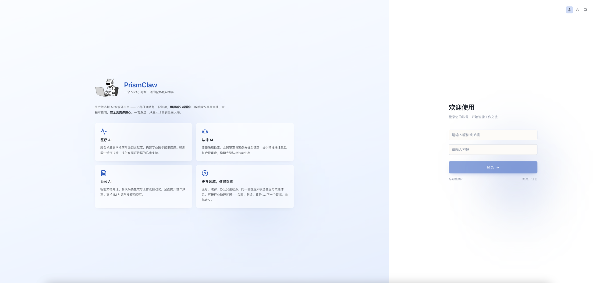
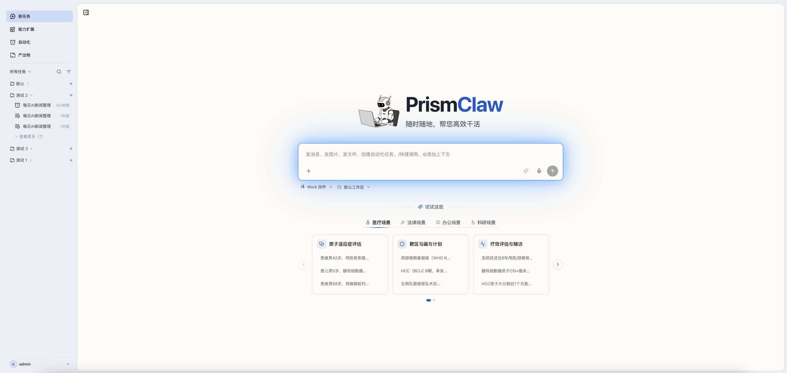
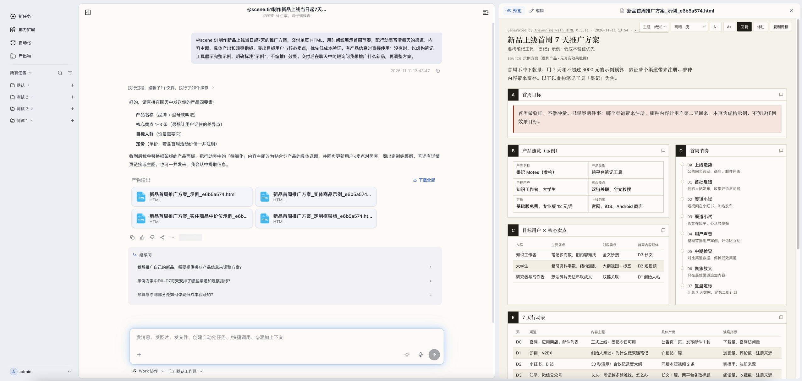
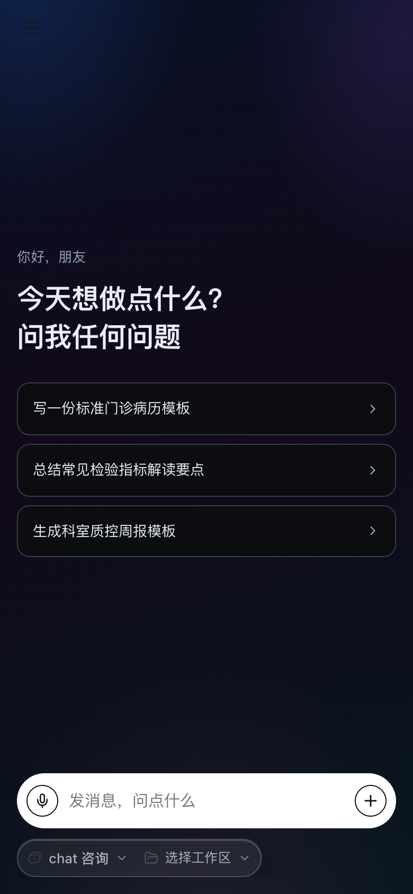
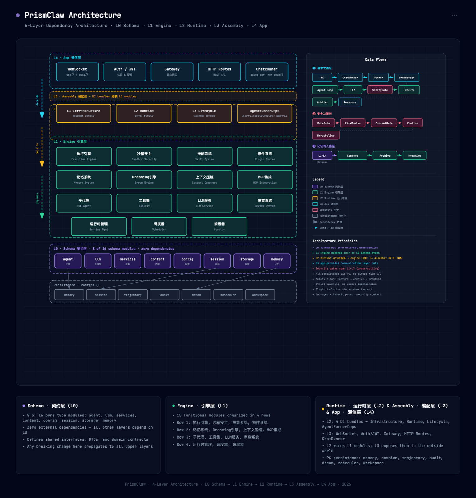

<div align="center">


# PrismClaw

**企业级 · 私有化 · 多用户 · 多 Agent**

运行于企业自有基础设施的 AI Agent 平台

[](./LICENSE)
[](https://www.python.org/)
[](https://react.dev/)
[](./deploy/DEPLOY.md)

</div>

---

## 一套系统，从三大场景到星辰大海

<picture>
  <source media="(prefers-color-scheme: dark)" srcset="./docs/website/assets/readme/pc-dark.png">
  
</picture>

<p align="center"><sub>PC 端 · 亮色 / 暗色随系统自动切换</sub></p>

运行于企业自有基础设施的企业级 AI Agent 平台。用自然语言下达任务，Agent 自主规划、调用工具，直接把结果交付成文件——全过程在企业安全边界内完成。

多用户与多 Agent 并行协作，会话、记忆与审计互不干扰；敏感操作须审批放行，支持双人复核与 MFA，全程可追溯。

一个组织一套部署：模型可对接内网推理服务，数据、记忆与审计留在自有存储；用户零安装，打开浏览器登录即用。

医疗、法律、办公只是起点，更多领域共享同一个垂直大模型基座：

<table>
  <tr>
    <td width="50%" valign="top">
      <h4>医疗 AI</h4>
      融合权威医学指南与循证文献库，构建专业医学知识底座。辅助医生诊疗决策，提供有循证依据的临床支持。
    </td>
    <td width="50%" valign="top">
      <h4>法律 AI</h4>
      覆盖法规检索、合同审查与案例分析全链路，提供精准法律意见与合规审查，构建完整法律技能生态。
    </td>
  </tr>
  <tr>
    <td width="50%" valign="top">
      <h4>办公 AI</h4>
      智能文档处理、会议摘要生成与工作流自动化，全面提升协作效率。支持 IM 对话与多模态交互。
    </td>
    <td width="50%" valign="top">
      <h4>更多领域，值得探索</h4>
      同一套垂直大模型基座与技能体系，可按行业快速扩展——金融、制造、政务……下一个领域，由你定义。
    </td>
  </tr>
</table>

---

## 说一句话，换一份可交付文件

输入框里写清目标，Agent 自主规划步骤、调用技能与工具；产出物在右侧实时预览，确认后直接下载。



<p align="center"><sub>工作台 · 场景示例一键填入，工作方式与协作区随手切换</sub></p>



<p align="center"><sub>会话 · 左侧任务流与追问建议，右侧实时预览 HTML 交付物并可直接下载</sub></p>

---

## 双端一致体验

PC 与移动端 H5 保持一致的界面与操作逻辑：登录、对话、任务、文件、自动化在两端都是熟悉的位置。亮色 / 暗色随系统自动切换，用户无需安装任何客户端。

<table>
  <tr>
    <td align="center" width="50%">
      
    </td>
    <td align="center" width="50%">
      
    </td>
  </tr>
  <tr>
    <td align="center"><sub>移动端 H5 · 亮色</sub></td>
    <td align="center"><sub>移动端 H5 · 暗色</sub></td>
  </tr>
</table>

---

## 核心能力

| 能力 | 说明 |
| --- | --- |
| **私有化部署** | 整套服务运行于企业自有基础设施，数据不落第三方；模型可对接内网自建推理服务，无需外网。 |
| **多用户与隔离** | 内置账号体系，会话、记忆与产物按用户隔离，多人共用一套平台互不干扰。 |
| **开箱即用** | 一条启动命令跑起全套服务；浏览器登录即用，PC 与移动端 H5 双端，用户零安装。 |
| **五层单向架构** | `schema → engine → runtime → assembly → app` 依赖严格单向，业务边界清晰，改一处不牵一片。 |
| **可水平扩展** | Worker 无状态，可按需横向扩容；节点异常自动接管，会话不中断。 |
| **四层记忆 + Dreaming** | L1 工作 / L2 会话 / L3 语义 / L4 归档；空闲时自动整理沉淀，越用越懂你。 |
| **安全治理** | 多层安全闸门、内核级沙箱、敏感数据防泄漏；敏感操作须确认放行，可开启 4-Eyes 双人复核与 MFA，审计日志不可篡改。 |
| **可扩展** | 技能、插件、MCP 与子代理均可插拔；新领域以分包方式接入，医疗域为参考实现。 |

---

## 架构

<a href="./docs/architecture/diagrams/system-architecture.html">
  
</a>

五层依赖严格单向；引擎层无状态、存储独立，Worker 可按需扩容。点击上图可查看交互式架构图解。

<details>
<summary>分层依赖（Mermaid）</summary>

```mermaid
graph TB
    subgraph L4["app — 通信层"]
        A1[WebSocket] ~~~ A2[Auth] ~~~ A3[Gateway] ~~~ A4[HTTP Routes]
    end
    subgraph L3["assembly — 编配层"]
        B1[Bundle 组装<br/>Infrastructure → Runtime → Lifecycle]
    end
    subgraph L2["runtime — 运行时层"]
        C1[engine facade] ~~~ C2[记忆编排] ~~~ C3[能力刷新] ~~~ C4[ChatService]
    end
    subgraph L1["engine — 引擎层（全部业务逻辑，无状态）"]
        D1[执行引擎] ~ D2[沙箱安全] ~ D3[技能] ~ D4[插件]
        D5[记忆] ~ D6[Dreaming] ~ D7[上下文压缩] ~ D8[MCP]
        D9[子代理] ~ D10[工具集] ~ D11[LLM 服务] ~ D12[审查]
    end
    subgraph L0["schema — 契约层（零依赖）"]
        E1[Protocol + 类型 + 配置]
    end
    subgraph Store["有状态存储（独立于 Worker）"]
        F1[("Redis<br/>会话 / 锁 / 消息队列 / L1")] ~ F2[("PostgreSQL<br/>L2-L4 / pgvector / 用户 / 审计")]
    end

    L4 --> L3 --> L2 --> L1 --> L0
    L1 --> Store
```

</details>

---

## 快速开始

> **环境要求**：Docker 24+（推荐），或源码方式：Python 3.12+、[uv](https://docs.astral.sh/uv/)、Node.js 18+、Redis 7、PostgreSQL 17（含 pgvector）。

### 方式一：Docker（推荐，单机起全套）

```bash
# 1. 生成本地配置
cd backend/configs && for f in *.example.yaml; do cp "$f" "${f%.example.yaml}.yaml"; done && cd ../..
cp deploy/configs/mcp.prod.example.yaml deploy/configs/mcp.prod.yaml
# 只需改 models.yaml 的模型端点与 API Key（可填内网 OpenAI 兼容服务）

# 2. 填写部署密钥与管理员密码
cd deploy && cp .env.example .env && ${EDITOR:-vim} .env

# 3. 启动（首次会构建镜像）
docker compose up -d
```

- 访问 `http://<服务器IP>:8000`，用 `.env` 里的管理员账号登录（首次启动时自动创建）。
- 停止用 `docker compose down`，日志用 `docker compose logs -f prismclaw`。

### 方式二：源码本地开发

```bash
cd backend && uv sync && cd ..
cd backend/configs && for f in *.example.yaml; do cp "$f" "${f%.example.yaml}.yaml"; done && cd ../..
# 编辑 models.yaml、server.yaml（jwt_secret）、infra.yaml（Redis / PostgreSQL）

./scripts/build-frontend.sh       # PC 端 → frontend/dist
./scripts/build-frontend-app.sh   # 移动端 H5 → frontend-app/dist/h5

export PRISMCLAW_WEB_USER_BOOTSTRAP_ADMIN_ID=admin
export PRISMCLAW_WEB_USER_BOOTSTRAP_ADMIN_PASSWORD='<设置一个强密码>'
./scripts/dev/start-local.sh      # 后端 + 本地静态托管（模拟 nginx）
open http://localhost:5173
```

| 本地入口 | 地址 |
| --- | --- |
| PC 端 | `http://localhost:5173` |
| 移动端 H5 | `http://localhost:10086` |
| 后端 API | `http://localhost:8000` |

- 停止用 `./scripts/dev/stop-local.sh`。
- 注册 / 找回密码依赖 SMTP，未配置时相关接口返回 503，登录不受影响。
- 前端热更新开发：`cd frontend && npm run dev`（`/api` 需指向后端）。

---

## 配置

`backend/configs/` 下 8 个 YAML，分别覆盖服务、存储、模型、Agent 与安全策略：

| 文件 | 配置内容 |
| --- | --- |
| `server` | 监听、运行时 / 工作区根、Web 通道、JWT、SMTP |
| `infra` | Redis、PostgreSQL |
| `models` | Provider、默认模型、embedding / vision / speech |
| `agent` | 迭代上限、上下文预算与压缩、超时重试 |
| `mcp` | MCP Server 定义 |
| `capabilities` | 技能 / 子代理 / 插件路径与配额 |
| `memory` | 四层记忆与 Dreaming 策展 |
| `security` | 沙箱、文件系统、网络、环境变量白名单 |

---

## 部署

| 形态 | 入口 | 适用 |
| --- | --- | --- |
| 单机 Docker（推荐） | [`deploy/docker-compose.yml`](./deploy/docker-compose.yml) | 一个组织、一台服务器，含 PG + Redis + Runtime-Agent |
| 多 Worker 集群 | [`deploy/docker-compose.multi.yml`](./deploy/docker-compose.multi.yml) | Nginx + 3 Worker，active-active |
| 源码生产 | `./scripts/start.sh`（停止 `./scripts/stop.sh`） | 只跑后端，前端由已有 nginx 托管 |
| 本地开发 | `cd frontend && npm run dev` | 前端热更新 |

完整部署手册（端口、证书、备份、环境变量清单）见 [deploy/DEPLOY.md](./deploy/DEPLOY.md)。

---

## 技术栈

| 维度 | 技术 |
| --- | --- |
| 架构 | 五层单向依赖 + 无状态 Worker + 有状态存储，active-active 扩展 |
| 后端 | Python 3.12+、FastAPI、Pydantic 2、SQLAlchemy 2（async）、litellm |
| 存储 | Redis 7、PostgreSQL 17（pgvector） |
| 前端 | React 19、TypeScript 5.8、Vite 6、Tailwind CSS 4、Zustand |
| 移动端 | Taro 4.3、React 18、SCSS |
| 安全 | bwrap 沙箱、JWT、DLP、BreakGlass、4-Eyes、WORM 审计、HSM |
| 可观测 | OpenTelemetry、Prometheus、结构化 JSON 日志 |
| 协议 | WebSocket、OpenAI 兼容 SSE、MCP（stdio / streamable-http） |

---

## 项目结构

```
backend/src/prismclaw/
├── schema/       L0 契约层：Protocol + 类型 + 配置（零依赖）
├── engine/       L1 引擎层：执行 · 安全 · 工具 · 记忆 · Dreaming · 压缩 · MCP · 子代理 · 插件
├── runtime/      L2 运行时层：engine 门面 + 记忆编排 / 能力刷新 / ChatService
├── assembly/     L3 编配层：Bundle 组装 + 插件编配
├── app/          L4 通信层：WebSocket · Chat · OpenAI SSE · 网关 · 认证
├── persistence/  存储实现：PG 记忆 / Redis 会话 / 用户 / 审计
└── infra/        基础设施：settings · redis · db · 启动校验

backend/src/subpackages/   领域分包（medical 为参考实现）
frontend/                  PC 端 SPA（Vite + React）
frontend-app/              移动端 H5（Taro）
deploy/                    容器编排 · nginx · 部署文档
scripts/                   构建 / 本地开发 / 生产启停
docs/architecture/         架构文档与交互式图解
```

---

## 文档

- [架构设计总览](./docs/architecture/architecture-prismclaw.md)
- [系统架构交互图](./docs/architecture/diagrams/system-architecture.html)

模块细纲：

| 分类 | 模块 |
| --- | --- |
| 执行与编排 | [执行引擎](./docs/architecture/modules/01-execution-engine.md) · [运行时](./docs/architecture/modules/13-runtime-management.md) · [调度器](./docs/architecture/modules/16-scheduler.md) · [子代理](./docs/architecture/modules/09-subagent.md) |
| 能力与集成 | [技能](./docs/architecture/modules/02-skill-system.md) · [插件](./docs/architecture/modules/03-plugin-system.md) · [MCP](./docs/architecture/modules/08-mcp-integration.md) · [工具集](./docs/architecture/modules/10-toolkit.md) |
| 记忆与知识 | [记忆](./docs/architecture/modules/05-memory-system.md) · [Dreaming](./docs/architecture/modules/06-dream-engine.md) · [上下文压缩](./docs/architecture/modules/07-context-compression.md) · [策展器](./docs/architecture/modules/15-curator.md) |
| 安全与通信 | [沙箱安全](./docs/architecture/modules/04-sandbox-security.md) · [Web 层](./docs/architecture/modules/12-web-layer.md) · [审查](./docs/architecture/modules/14-review-system.md) · [LLM 服务](./docs/architecture/modules/11-llm-service.md) |

- [部署手册](./deploy/DEPLOY.md) · [贡献指南](./CONTRIBUTING.md) · [安全策略](./SECURITY.md)

---

## 贡献与安全

欢迎 Issue 与 PR，开发流程见 [CONTRIBUTING.md](./CONTRIBUTING.md)。安全漏洞请勿公开披露，上报方式见 [SECURITY.md](./SECURITY.md)。

## 许可证

[MIT](./LICENSE)
