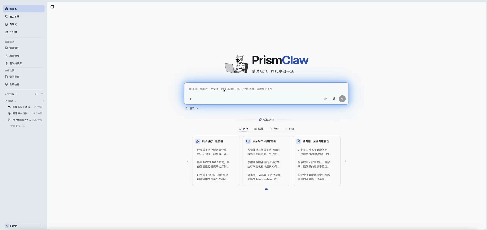
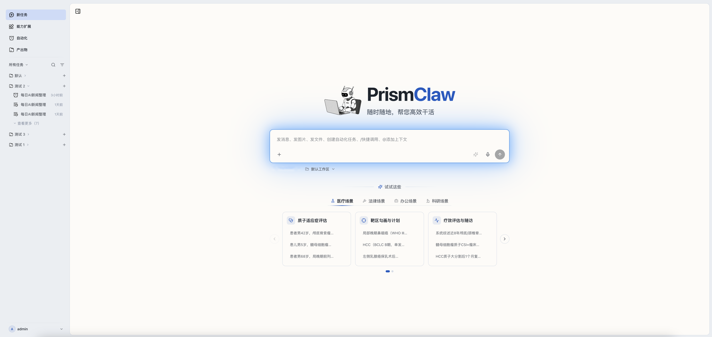
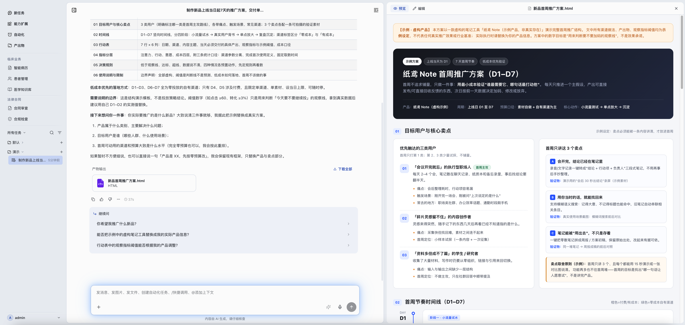
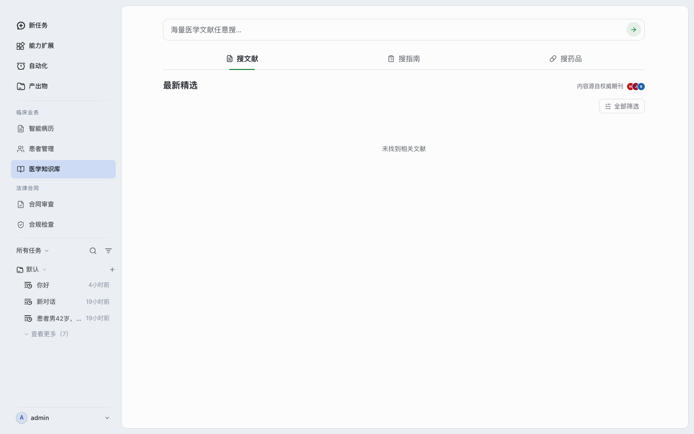
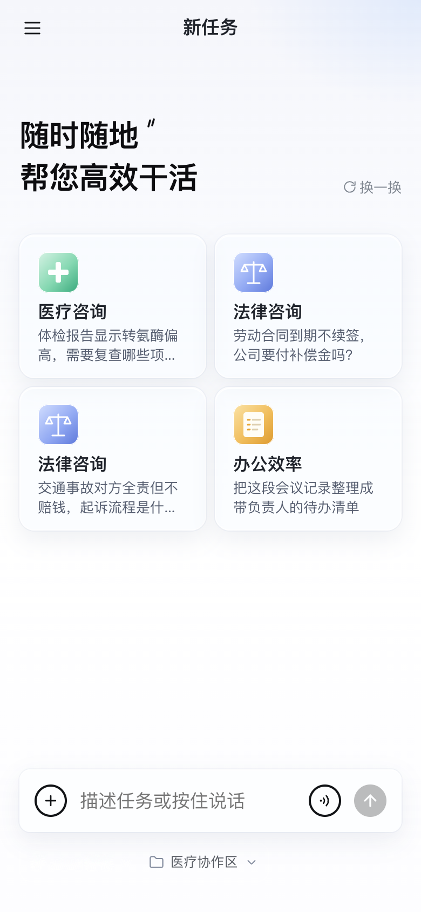
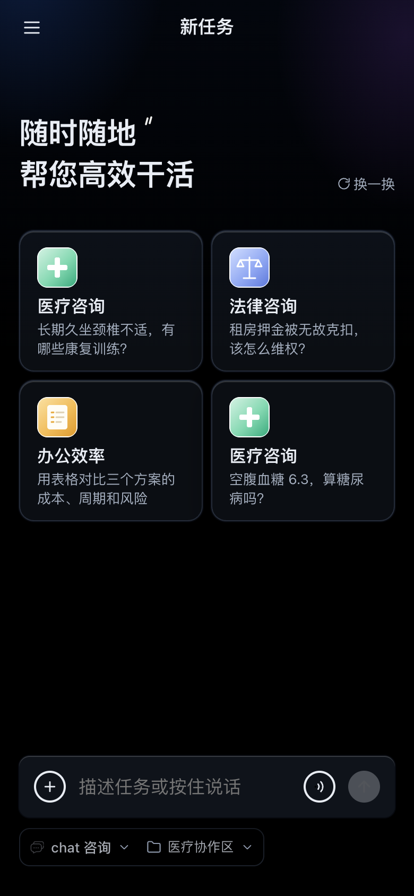
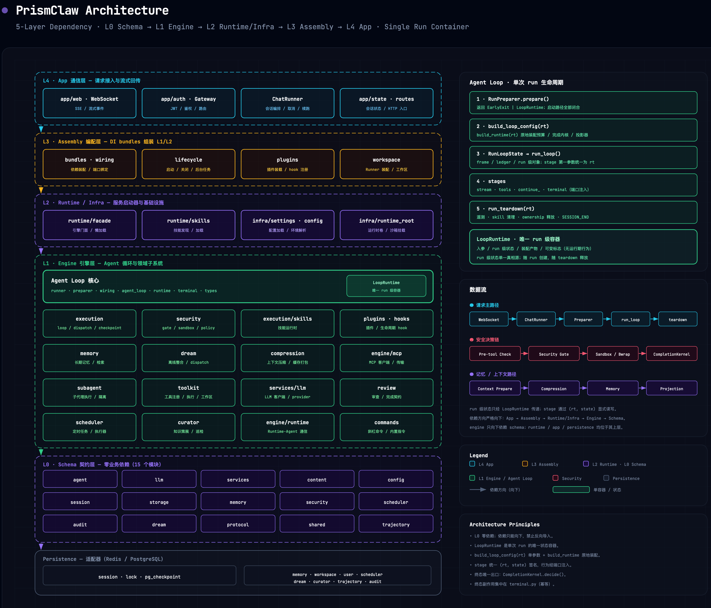

<div align="center">


# PrismClaw

**企业级 · 私有化 · 多用户 · 多 Agent**

把 AI Agent 放回企业自己的基础设施上

[](./LICENSE)
[](https://www.python.org/)
[](https://react.dev/)
[](./deploy/DEPLOY.md)

[English](./README.md) · **简体中文**



<p align="center"><sub>真实运行演示 · 切换场景 → 下达任务 → 左侧执行过程 · 右侧交付物下载</sub></p>

</div>

---

## 为什么做这个

大多数 AI 工具默认三件事：网络随便连、用户会配置、聊完就算完成。这三条，在企业里一条都不成立。

- **数据出不去。** 病历、合同、内部文档不能上传到公共云，这不是合规偏好，是硬约束。
- **用户不配置。** 医生、律师、行政人员不会为了用上一个工具，去读插件文档、填模型端点、管密钥。要他们先配置，等于没有这工具。
- **交付不是聊天。** 他们要的是一份能签字、能发出去、能归档的文件，不是一段还得自己整理的问答。

所以 PrismClaw 把这三件事反过来做：整套服务部署在企业自己的机房，员工打开浏览器就能用，任务结束时递上的是文件。它不是一个聊天框，而是一套把 Agent 送进业务流程里的交付系统。

---

## 场景与交付，边界说清楚

PC 工作台提供**医疗、法律、办公、科研**四类任务入口。它们共享同一套 Agent 基座，但建设状态并不相同；入口可见，不等于都已有完整专属工作台。

| 场景 | 当前形态 | 任务与交付 |
| --- | --- | --- |
| **医疗** | 参考实现，专属工作台已接入 | 病历与病程整理、指南 / 文献 / 药品检索、剂量学对比、随访与复查计划；循证内容强调出处，诊疗决策仍由医生作出 |
| **法律** | 导航与页面骨架已接入，专属工作台建设中 | 合同审查、合规检查入口已可见；具体审查与整改交付待专属工作台完成 |
| **办公** | 通用 Agent 任务场景 | 文档处理与格式转换、会议纪要与待办拆解、流程自动化，交付 HTML / Markdown 报告、表格或文件 |
| **科研** | 通用 Agent 任务场景 | 文献调研、资料整理、综述初稿与数据分析；实际结果取决于已接入的模型、工具与数据源 |

---

## 一份任务怎么走完

1. **说清楚要什么。** 用自然语言描述目标，选一个工作区，必要时 @ 上文件或知识库。
2. **Agent 自己拆步骤。** 规划、检索、调用技能与工具、读文件、写代码、生成文档，过程在左侧逐条可见。
3. **成果在右侧实时预览。** 不满意就追问一句，改的是同一份产物，不用重开一轮。
4. **确认后拿走。** 下载文件；触碰敏感动作（对外发送、写入系统、批量修改）时，它会停下来等人放行。



<p align="center"><sub>真实运行截图 · 工作台：场景示例一键填入，工作区随手切换</sub></p>

<table>
  <tr>
    <td width="50%" valign="top">
      
      <p align="center"><sub>会话 · 左侧任务流，右侧实时预览交付物并可直接下载</sub></p>
    </td>
    <td width="50%" valign="top">
      
      <p align="center"><sub>医学知识库 · 检索入口与结果区域；当前截图环境暂无文献数据</sub></p>
    </td>
  </tr>
</table>

---

## 这些事，我们故意不做

### 不开放扩展

把技能、插件、MCP 全部开放给用户自己装，听起来很自由。但在真实企业里，自由通常意味着版本错配、依赖冲突、密钥泄露，最后没人说得清是哪一步坏的。可扩展性应该由 IT 在验收阶段承担，不该由一线用户承担。

> 企业级产品的诚意，不是把螺丝刀递给你，而是把装好的机器交给你。PrismClaw 内置的技能与工具，每一个都经过逐个适配与回归验证；没有放出来的，是我们不敢让你踩的。

### 不做本地客户端

本地客户端能更贴近系统、响应更快，这些理由都成立。但它的代价是：每台机器都要装、都要升级、都要排障。一个科室二十台电脑，就是二十个维护点。

PrismClaw 选择 B/S：服务端一次部署，用户打开浏览器就能用。对 IT 来说是一处维护；对用户来说，是零安装。

> 让医生、律师、行政去理解插件版本、密钥、模型端点，等于把成本转嫁给最没有能力承担的人。

### 不留多余的按钮

配置项越多，看起来越专业，也越容易让人在第一屏就放弃。每多一个开关，就多一次「我该选什么」的犹豫，而绝大多数用户并不想为这个系统做判断。

> 界面上的每个按钮，都是在向用户要一次判断。我们把判断留在后台：模型怎么选、上下文怎么拼、技能怎么调，都不需要用户知道。用户只做两件事：说出你要什么，拿走你要的东西。

界面因此保持克制：一个输入框、一个任务列表、一个成果预览区。剩下的复杂度，被收在系统内部。

---

## 能力，用人话说

| 能力 | 意味着什么 |
| --- | --- |
| **私有化部署** | 整套服务跑在企业自己的机器上，数据不落第三方；模型可接内网推理服务，全程不出网。 |
| **多用户与隔离** | 账号、会话、记忆、产物按用户隔离，一套平台给全组织用，彼此看不到对方的东西。 |
| **开箱即用** | 一条命令起全套服务，浏览器登录即用；PC 与移动端 H5 双端一致，用户零安装。 |
| **五层单向架构** | `schema → engine → runtime → assembly → app` 依赖严格单向，业务边界清晰，改一处不牵一片。 |
| **可水平扩展** | Worker 无状态，按需横向扩容；节点异常自动接管，会话不中断。 |
| **四层记忆 + Dreaming** | L1 工作 / L2 会话 / L3 语义 / L4 归档；空闲时自动整理沉淀，越用越懂你的业务。 |
| **安全治理** | 多层安全闸门、内核级沙箱、敏感数据防泄漏；敏感操作走任务级确认，全程可追溯。 |
| **领域能力接入** | 领域能力以分包接入、由 IT 统一验收，终端用户无需配置；医疗域为参考实现。 |

---

## 双端一致，无需客户端

PC 工作台与移动端 H5 保持一致的信息层级与操作逻辑，亮色 / 暗色随系统切换。以下均为真实运行截图。

<table>
  <tr>
    <td align="center" width="50%">
      
    </td>
    <td align="center" width="50%">
      
    </td>
  </tr>
  <tr>
    <td align="center"><sub>移动端 H5 · 亮色</sub></td>
    <td align="center"><sub>移动端 H5 · 暗色</sub></td>
  </tr>
</table>

<p align="center"><sub>浏览器登录即用，无需安装任何客户端</sub></p>

---

## 装在哪，多久能用

> 客户端什么都不用装。服务器一侧准备好，员工打开浏览器登录即可。

> **环境要求**：Docker 24+（推荐），或源码方式：Python 3.12+、[uv](https://docs.astral.sh/uv/)、Node.js 18+、Redis 7、PostgreSQL 17（VectorChord Suite：`vchord` / `pg_tokenizer` / `vchord_bm25` / `vector`）。

### 方式一：Docker（推荐，单机起全套）

```bash
# 1. 生成本地配置
cd backend/configs && for f in *.example.yaml; do cp "$f" "${f%.example.yaml}.yaml"; done && cd ../..
# 如需额外 MCP 连接器，编辑 deploy/configs/mcp.prod.json
# 只需改 models.yaml 的模型端点与 API Key（可填内网 OpenAI 兼容服务）

# 2. 填写部署密钥与管理员密码
cd deploy && cp .env.example .env && ${EDITOR:-vim} .env

# 3. 启动（首次会构建镜像）
docker compose up -d
```

- 访问 `http://<服务器IP>:8000`，用 `.env` 里的管理员账号登录（首次启动时自动创建）。
- 停止用 `docker compose down`，日志用 `docker compose logs -f prismclaw`。

### 方式二：源码本地开发

```bash
cd backend && uv sync && cd ..
cd backend/configs && for f in *.example.yaml; do cp "$f" "${f%.example.yaml}.yaml"; done && cd ../..
# 编辑 models.yaml、server.yaml（jwt_secret）、infra.yaml（Redis / PostgreSQL）

./scripts/build-frontend.sh       # PC 端 → frontend/dist
./scripts/build-frontend-app.sh   # 移动端 H5 → frontend-app/dist/h5

export PRISMCLAW_WEB_USER_BOOTSTRAP_ADMIN_ID=admin
export PRISMCLAW_WEB_USER_BOOTSTRAP_ADMIN_PASSWORD='<设置一个强密码>'
./scripts/dev/start-local.sh      # 后端 + 本地静态托管（模拟 nginx）
open http://localhost:5173
```

| 本地入口 | 地址 |
| --- | --- |
| PC 端 | `http://localhost:5173` |
| 移动端 H5 | `http://localhost:10086` |
| 后端 API | `http://localhost:8000` |

- 停止用 `./scripts/dev/stop-local.sh`。
- 注册 / 找回密码依赖 SMTP，未配置时相关接口返回 503，登录不受影响。
- 前端热更新开发：`cd frontend && npm run dev`（`/api` 需指向后端）。

---

## 边界与问答

**它不能做什么：**

- 不替代 HIS / EMR：它读、它整理、它起草，但不接管医院的核心业务系统。
- 不给诊断结论：输出的是有出处的证据与选项，诊断责任始终在医生。
- 不外发：模型可以全部走内网推理，敏感内容不出企业边界。
- 不静默执行敏感操作：发送、写入、批量修改前一定停下等人确认。

**常见问题：**

| 问题 | 回答 |
| --- | --- |
| 需要连外网吗？ | 不必。模型可接内网 OpenAI 兼容服务，检索与推理都在内网完成。 |
| 用户要装什么？ | 什么都不用装，浏览器打开就能用。 |
| 数据存在哪？ | 企业自己的 Redis / PostgreSQL，备份与审计由企业掌控。 |
| 上手要多久？ | 登录后第一句话就能开始；不需要培训配置项，因为它没有配置项。 |

---

## 谁在做

PrismClaw 由 [JsonShare](https://github.com/JsonShare) 维护，目标是给企业一套能真正落地、能长期运行的 Agent 基础设施，而不是又一个演示 Demo。医疗域作为参考实现完整开源，新领域沿用同一套分层与接入方式。

- 发现问题或有想法：提交 [Issue](https://github.com/JsonShare/PrismClaw/issues)
- 想一起改：先看 [CONTRIBUTING.md](./CONTRIBUTING.md)
- 安全漏洞：请勿公开披露，方式见 [SECURITY.md](./SECURITY.md)

---

# 附录

## 架构

<a href="./docs/architecture/diagrams/system-architecture.html">
  
</a>

五层依赖严格单向；引擎层无状态、存储独立，Worker 可按需扩容。点击上图可查看交互式架构图解。

<details>
<summary>分层依赖（Mermaid）</summary>

```mermaid
graph TB
    subgraph L4["app — 通信层"]
        A1[WebSocket] ~~~ A2[Auth] ~~~ A3[Gateway] ~~~ A4[HTTP Routes]
    end
    subgraph L3["assembly — 编配层"]
        B1[Bundle 组装<br/>Infrastructure → Runtime → Lifecycle]
    end
    subgraph L2["runtime — 运行时层"]
        C1[engine facade] ~~~ C2[记忆编排] ~~~ C3[能力刷新] ~~~ C4[ChatService]
    end
    subgraph L1["engine — 引擎层（全部业务逻辑，无状态）"]
        D1[执行引擎] ~ D2[沙箱安全] ~ D3[技能] ~ D4[插件]
        D5[记忆] ~ D6[Dreaming] ~ D7[上下文压缩] ~ D8[MCP]
        D9[子代理] ~ D10[工具集] ~ D11[LLM 服务] ~ D12[审查]
    end
    subgraph L0["schema — 契约层（零依赖）"]
        E1[Protocol + 类型 + 配置]
    end
    subgraph Store["有状态存储（独立于 Worker）"]
        F1[("Redis<br/>会话 / 锁 / 消息队列 / L1")] ~ F2[("PostgreSQL<br/>L2-L4 / VectorChord / 用户 / 审计")]
    end

    L4 --> L3 --> L2 --> L1 --> L0
    L1 --> Store
```

</details>

## 配置

`backend/configs/` 下 8 个 YAML，分别覆盖服务、存储、模型、Agent 与安全策略：

| 文件 | 配置内容 |
| --- | --- |
| `server` | 监听、运行时 / 工作区根、Web 通道、JWT、SMTP |
| `infra` | Redis、PostgreSQL |
| `models` | Provider、默认模型、embedding / vision / speech |
| `agent` | 迭代上限、上下文预算与压缩、超时重试 |
| `mcp` | MCP Server 定义 |
| `capabilities` | 技能 / 子代理 / 插件路径与配额 |
| `memory` | 四层记忆与 Dreaming 策展 |
| `security` | 沙箱、文件系统、网络、环境变量白名单 |

## 部署

| 形态 | 入口 | 适用 |
| --- | --- | --- |
| 单机 Docker（推荐） | [`deploy/docker-compose.yml`](./deploy/docker-compose.yml) | 一个组织、一台服务器，含 PG + Redis + Runtime-Agent |
| 多 Worker 集群 | [`deploy/docker-compose.multi.yml`](./deploy/docker-compose.multi.yml) | Nginx + 3 Worker，active-active |
| 源码生产 | `./scripts/start.sh`（停止 `./scripts/stop.sh`） | 只跑后端，前端由已有 nginx 托管 |
| 本地开发 | `cd frontend && npm run dev` | 前端热更新 |

完整部署手册（端口、证书、备份、环境变量清单）见 [deploy/DEPLOY.md](./deploy/DEPLOY.md)。

## 技术栈

| 维度 | 技术 |
| --- | --- |
| 架构 | 五层单向依赖 + 无状态 Worker + 有状态存储，active-active 扩展 |
| 后端 | Python 3.12+、FastAPI、Pydantic 2、SQLAlchemy 2（async）、litellm |
| 存储 | Redis 7、PostgreSQL 17（VectorChord Suite） |
| 前端 | React 19、TypeScript 5.8、Vite 6、Tailwind CSS 4、Zustand |
| 移动端 | Taro 4.3、React 18、SCSS |
| 安全 | bwrap 沙箱、JWT、DLP、BreakGlass、HSM |
| 可观测 | OpenTelemetry、Prometheus、结构化 JSON 日志 |
| 协议 | WebSocket、OpenAI 兼容 SSE、MCP（stdio / streamable-http） |

## 项目结构

```
backend/src/prismclaw/
├── schema/       L0 契约层：Protocol + 类型 + 配置（零依赖）
├── engine/       L1 引擎层：执行 · 安全 · 工具 · 记忆 · Dreaming · 压缩 · MCP · 子代理 · 插件
├── runtime/      L2 运行时层：engine 门面 + 记忆编排 / 能力刷新 / ChatService
├── assembly/     L3 编配层：Bundle 组装 + 插件编配
├── app/          L4 通信层：WebSocket · Chat · OpenAI SSE · 网关 · 认证
├── persistence/  存储实现：PG 记忆 / Redis 会话 / 用户 / 审计
└── infra/        基础设施：settings · redis · db · 启动校验

backend/src/subpackages/   领域分包（medical 为参考实现）
frontend/                  PC 端 SPA（Vite + React）
frontend-app/              移动端 H5（Taro）
deploy/                    容器编排 · nginx · 部署文档
scripts/                   构建 / 本地开发 / 生产启停
docs/architecture/         架构文档与交互式图解
```

## 文档

- [架构设计总览](./docs/architecture/architecture-prismclaw.md)
- [系统架构交互图](./docs/architecture/diagrams/system-architecture.html)

模块细纲：

| 分类 | 模块 |
| --- | --- |
| 执行与编排 | [执行引擎](./docs/architecture/modules/01-execution-engine.md) · [运行时](./docs/architecture/modules/13-runtime-management.md) · [调度器](./docs/architecture/modules/16-scheduler.md) · [子代理](./docs/architecture/modules/09-subagent.md) |
| 能力与集成 | [技能](./docs/architecture/modules/02-skill-system.md) · [插件](./docs/architecture/modules/03-plugin-system.md) · [MCP](./docs/architecture/modules/08-mcp-integration.md) · [工具集](./docs/architecture/modules/10-toolkit.md) |
| 记忆与知识 | [记忆](./docs/architecture/modules/05-memory-system.md) · [Dreaming](./docs/architecture/modules/06-dream-engine.md) · [上下文压缩](./docs/architecture/modules/07-context-compression.md) · [策展器](./docs/architecture/modules/15-curator.md) |
| 安全与通信 | [沙箱安全](./docs/architecture/modules/04-sandbox-security.md) · [Web 层](./docs/architecture/modules/12-web-layer.md) · [审查](./docs/architecture/modules/14-review-system.md) · [LLM 服务](./docs/architecture/modules/11-llm-service.md) |

## 贡献与安全

欢迎 Issue 与 PR，开发流程见 [CONTRIBUTING.md](./CONTRIBUTING.md)。安全漏洞请勿公开披露，上报方式见 [SECURITY.md](./SECURITY.md)。

## 许可证

[MIT](./LICENSE)
